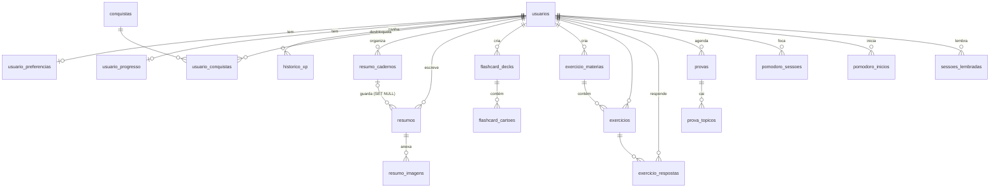

# 🗄️ Banco de dados

MySQL/MariaDB, `utf8mb4`, motor InnoDB. A estrutura completa está em
[`Backend/kosmos.sql`](../Backend/kosmos.sql). As mudanças entram como migrações
datadas em [`Backend/sql/`](../Backend/sql/), aplicadas pelo `migrar.php`
(ver o README).

## Diagrama

Todas as tabelas com `usuario_id` apontam para `usuarios` com `ON DELETE CASCADE`:
apagar a conta apaga todos os dados da pessoa junto (LGPD). A única exceção de
comportamento é `resumos.caderno_id`, com `ON DELETE SET NULL`: apagar um caderno
devolve os resumos para "Sem caderno", sem apagar o que a pessoa escreveu.

Tabelas sem ligação com `usuarios`: `niveis_config` e `recompensas` (catálogos
fixos da progressão), `conquistas` (catálogo), `tentativas_acesso` (limite de
tentativas, indexada por e-mail/IP) e `migracoes` (controle do `migrar.php`).

## Tabelas

| Tabela | Para quê | Observações |
|---|---|---|
| `usuarios` | conta, senha (bcrypt), Google, sequência de dias | `email` e `google_id` únicos; `sessoes_versao` derruba as outras sessões; `reset_token` e `confirma_token` guardam só o **hash** do token; `email_confirmado` = 0 só no cadastro por e-mail ainda não confirmado |
| `usuario_preferencias` | avatar, tempos do pomodoro, meta diária, matérias, onboarding, tour e dicas do Orion já vistas, notificações | 1 linha por usuário, criada no primeiro acesso |
| `usuario_progresso` | XP total, nível e título atuais | cache: a verdade é a soma de `historico_xp` |
| `historico_xp` | cada ganho de XP, com a origem | nada soma XP sem deixar uma linha aqui |
| `niveis_config` | XP de cada nível e o título | catálogo (50 níveis) |
| `conquistas` / `usuario_conquistas` | catálogo de conquistas e quem desbloqueou | |
| `recompensas` | molduras, cores e emblemas por nível | equipar é validado no servidor |
| `resumo_cadernos` | cadernos (pastas) de resumos | cor, ícone, capa e ordem |
| `resumos` | título, matéria e texto | índice FULLTEXT (`ft_resumo`) para a busca |
| `resumo_imagens` | fotos anexadas a um resumo | o arquivo fica em `Backend/uploads/resumos/` |
| `flashcard_decks` / `flashcard_cartoes` | baralhos e cartões | `proxima_revisao` e `facilidade` = repetição espaçada |
| `exercicio_materias` / `exercicios` | matérias e listas de questões (geradas por IA) | as questões ficam em JSON em `exercicios.conteudo` |
| `exercicio_respostas` | cada resposta, para o XP | 1 XP por questão por dia (UNIQUE) |
| `provas` / `prova_topicos` | provas marcadas e os assuntos que caem | |
| `pomodoro_sessoes` | cada ciclo de foco concluído | UNIQUE (`usuario_id`, `fim_em`): duas abas não duplicam |
| `pomodoro_inicios` | o Iniciar de cada ciclo de foco, por aparelho | o ciclo só é gravado se a duração dele passou desde aqui; gravar apaga a linha |
| `sessoes_lembradas` | o "Lembrar de mim" de cada aparelho (30 dias) | guarda só o **hash** do validador do cookie; `sessoes_versao` antiga = não vale mais |
| `tentativas_acesso` | limite de login, cadastro, "esqueci a senha", reenvio da confirmação e IA | linhas com mais de 1 dia são apagadas sozinhas |
| `migracoes` | quais arquivos de `Backend/sql/` já rodaram | criada pelo `migrar.php` |

## Regra de datas

Toda data é **calculada pelo MySQL** (`NOW()`, `CURDATE()`, `DATEDIFF()`), e o PHP
só formata (`datas.php`). Desde o `bootstrap.php`, PHP e MySQL também usam o mesmo
fuso (`America/Sao_Paulo` / `-03:00`). A regra continua valendo como segunda
proteção: foi a mistura dos dois relógios que fez a sequência de dias somar +1 a
cada recarga (ver o histórico no README).

## Ao mudar o banco

1. Crie `Backend/sql/AAAA-MM-DD_assunto.sql`, que possa rodar de novo sem erro
   (`IF NOT EXISTS`, `ADD COLUMN IF NOT EXISTS`...).
2. Replique a mudança no `Backend/kosmos.sql`.
3. Rode `C:\xampp\php\php.exe Backend/sql/migrar.php`.
4. Se a mudança criar tabela ou relação, atualize este arquivo.
